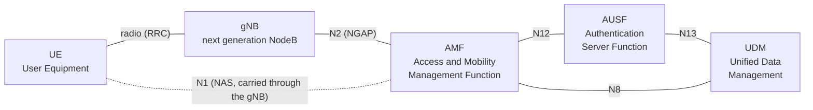

# 01 · 5G registration

Terms in **bold links** point to the [glossary](../glossary.md); each glossary row has a "back to topic" link.

## What you will learn

- Which protocol carries each message on each hop.
- What a UE must do before it can use a 5G network, and why it cannot send data yet.
- Who the main functions are and which interface connects each pair.
- The message sequence of an initial registration, simplified.
- Which parts are fixed by the standard and which depend on the vendor.

*The diagram loops. Bright arrows are the current step, dimmed ones are done. Open the SVG file directly in a browser and hover an arrow to pause it and read what it does; the same text is in [Message by message](#message-by-message).*

## The cast

The [**5GC**](../glossary.md#5gc) is built as a [**SBA**](../glossary.md#sba): each [**NF**](../glossary.md#nf) offers services to the others, instead of every pair having its own dedicated link.

- [**UE**](../glossary.md#ue): the device. It holds a [**SIM / USIM**](../glossary.md#sim) with the subscriber identity and a secret key.

- [**gNB**](../glossary.md#gnb): the base station, part of the [**RAN**](../glossary.md#ran). It relays signalling; it does not decide anything about the subscriber.

- [**AMF**](../glossary.md#amf): receives the registration, tracks the UE, and calls the other functions.

- [**AUSF**](../glossary.md#ausf): runs the authentication on behalf of the AMF.

- [**UDM**](../glossary.md#udm): holds the subscriber data and the key material.

- [**NRF**](../glossary.md#nrf): the phone book. Before the AMF calls the AUSF or the UDM it finds them through the NRF. The NRF is not drawn in the diagram to keep it readable, but it is used in every step that starts a call between two NFs.

### Interfaces used in this flow

Who talks to whom, and over which reference point (order of messages is in the animated diagram above):

| Reference point | Between | Carries |
|---|---|---|
| [**N1**](../glossary.md#n1) | UE – AMF | [**NAS**](../glossary.md#nas) signalling |
| [**N2**](../glossary.md#n2) | gNB – AMF | [**NGAP**](../glossary.md#ngap) signalling |
| [**N8**](../glossary.md#n8) | UDM – AMF | subscription and registration data |
| [**N12**](../glossary.md#n12) | AMF – AUSF | authentication requests |
| [**N13**](../glossary.md#n13) | UDM – AUSF | authentication data |

### Three signalling layers, one message

The Registration Request is a [**NAS**](../glossary.md#nas) message for the AMF. On the radio hop it rides inside [**RRC**](../glossary.md#rrc) (UE to gNB). The gNB then puts it inside an [**NGAP**](../glossary.md#ngap) message to the AMF. Same content, three envelopes.

### Protocol stack per hop

| Hop | Protocol stack | Notes |
|---|---|---|
| UE – gNB | [**RRC**](../glossary.md#rrc) over the radio interface | The [**NAS**](../glossary.md#nas) message is carried inside RRC. |
| gNB – AMF ([**N2**](../glossary.md#n2)) | [**NGAP**](../glossary.md#ngap) over [**SCTP**](../glossary.md#sctp) over [**IP**](../glossary.md#ip) | The NAS message is carried inside NGAP. The NG-RAN node sets up the SCTP association with the AMF. |
| AMF – AUSF ([**N12**](../glossary.md#n12)), AUSF – UDM ([**N13**](../glossary.md#n13)), AMF – UDM ([**N8**](../glossary.md#n8)), any NF – NRF | [**HTTP/2**](../glossary.md#http2) with [**JSON**](../glossary.md#json) bodies over [**TCP**](../glossary.md#tcp) | The service-based interfaces. The specs also define transport-layer protection ([**TLS**](../glossary.md#tls)); whether it is enabled depends on the deployment. |

[**NAS**](../glossary.md#nas) is not a transport: it is the content that RRC and NGAP carry, which is why the gNB forwards it without reading it.

### Identities: SUPI, SUCI, 5G-GUTI

The permanent identity is the [**SUPI**](../glossary.md#supi). To avoid sending it in clear over the air, the UE sends a [**SUCI**](../glossary.md#suci): the SUPI encrypted with the operator's public key. The [**SIDF**](../glossary.md#sidf) (part of the UDM) reverses it. After registration the AMF hands out a temporary [**5G-GUTI**](../glossary.md#guti) for later use.

## The flow

1. **Registration Request.** The UE sends it (NAS) to the gNB over RRC. It carries the SUCI (or a temporary identity if it has one).
2. **Initial UE Message.** The gNB cannot read the NAS content. It forwards it to an AMF over N2 in an NGAP *Initial UE Message*. The gNB selects the AMF; the AMF may later redirect the UE to a more suitable one.
3. **Authentication request towards the AUSF.** The AMF calls `Nausf_UEAuthentication_Authenticate` on the AUSF with the SUCI and the serving network name. The AUSF calls `Nudm_UEAuthentication_Get` on the UDM, which de-conceals the SUCI to the SUPI, selects the method and returns the authentication data.
4. **Challenge and NAS security.** The AMF sends an Authentication Request to the UE; the UE checks it with its SIM and answers. The AMF (with the AUSF) verifies the answer. Then the AMF sends a Security Mode Command and the UE confirms. From here NAS messages are protected.
5. **Registration with the UDM.** The AMF registers itself as the serving AMF (`Nudm_UECM_Registration`) and reads the subscription (`Nudm_SDM_Get`, with `Nudm_SDM_Subscribe` to be told about changes). Optionally it also fetches an access and mobility policy from the [**PCF**](../glossary.md#pcf).
6. **Registration Accept.** The AMF answers with Registration Accept, including a 5G-GUTI, and the UE replies with Registration Complete.

## Message by message

The animated diagram shows these explanations when you hover an arrow, but only if you open the SVG file directly in a browser (GitHub shows it inside an image, where hover does not work). The same text, as a table:

| # | Message | What happens |
|---|---|---|
| 1 | Registration Request (UE to gNB, over radio) | The UE asks to join. It identifies itself with a SUCI: its permanent identity (SUPI) encrypted, so the radio link never shows who it is. On this hop the NAS message rides inside RRC. The gNB forwards it but cannot read the NAS content. |
| 2 | Initial UE Message (gNB to AMF, N2) | The gNB wraps the same NAS message in an NGAP message and sends it to an AMF. It is the first NAS message the AMF sees for this UE. New envelope, same content: the gNB still does not interpret what is inside. |
| 3 | Nausf_UEAuthentication_Authenticate (AMF to AUSF, N12) | The AMF asks the AUSF to authenticate the subscriber, sending the SUCI and the serving network name. The AMF found the AUSF by asking the NRF (the phone book of the core). |
| 4 | Nudm_UEAuthentication_Get (AUSF to UDM, N13) | The AUSF asks the UDM for authentication data. The UDM de-conceals the SUCI into the SUPI (SIDF) and selects the method. The method is 5G AKA or EAP-AKA'. The subscriber credentials live on the UDM side. |
| 5 | Authentication data (UDM to AUSF) | The UDM answers with the SUPI and an authentication vector for the selected method. The vector contains the challenge for the SIM and the value expected back. |
| 6 | Authentication data (AUSF to AMF) | The AUSF passes the challenge to the AMF (in 5G AKA it keeps the expected result to check the UE's reply later). The AMF now has what it needs to challenge the UE. |
| 7 | Authentication Request (AMF to UE, N1) | The challenge reaches the UE as a NAS message through the gNB. The SIM computes an answer. The SIM also checks the challenge is genuine, so the UE verifies the network too (mutual authentication). |
| 8 | Authentication Response (UE to AMF) | The UE returns its answer. If it matches what the network expects, the UE is authenticated. A wrong answer ends in a registration failure. This is where a bad SIM or key mismatch shows up. |
| 9 | Security Mode Command (AMF to UE) | The AMF tells the UE which NAS integrity and ciphering algorithms to use. From the next NAS message on, signalling between UE and AMF is protected. |
| 10 | Security Mode Complete (UE to AMF) | The UE confirms and applies the chosen algorithms. Security context established: the AMF can now trust and protect the signalling. |
| 11 | Nudm_UECM_Registration + Nudm_SDM_Get (AMF to UDM, N8) | UECM = UE Context Management: the AMF tells the UDM it is the serving AMF for this UE. SDM = Subscriber Data Management: it reads the subscription. Nudm_SDM_Subscribe (not drawn) asks the UDM to notify the AMF if the subscription changes. |
| 12 | Subscription data (UDM to AMF) | The UDM returns what the subscriber is allowed to use. The AMF keeps it to take later decisions. If this step fails or data is missing, registration can fail even though authentication passed. |
| 13 | Registration Accept (AMF to UE, N1) | The AMF accepts the registration and assigns a temporary identity, the 5G-GUTI. The UE is now registered and the AMF knows where it is. It still cannot send data. |
| 14 | Registration Complete (UE to AMF) | The UE acknowledges the new 5G-GUTI. Registered, but no data session yet. That is the next topic: PDU session. |

### Authentication methods

The UDM chooses between [**5G AKA**](../glossary.md#aka) and [**EAP-AKA'**](../glossary.md#eapaka). In both, the SIM and the network prove to each other that they know the same secret key, without sending the key.

### What registration does *not* do

It does not create a data session. The UE is known and allowed on the network, but it cannot browse yet. That is the next topic (PDU session).

## Standard vs. implementation

| Defined by the standard | Left to the vendor / operator |
|---|---|
| Message names and order, reference points, service operation names | How the AMF is deployed (VMs, containers), how many instances, how they are scaled |
| Identity concealment and authentication procedures | Timers, retry policies and overload thresholds beyond the minimums |
| What each NF is responsible for | Logging format, counters, dashboards, alarms |
| | Whether the UDM is backed by one database or several, and how it is replicated |

Failure behaviour (what a UE sees when a step fails) is specified through cause values; what *operators* do to find the root cause is implementation. Scenarios will cover that.

## Scenarios

- [The AMF is overloaded and the platform cannot create more instances](scenarios/amf-overload-no-capacity.md)
- Planned: a subset of subscribers cannot register.

## References

- [**3GPP**](../glossary.md#3gpp) specs, each a [**TS**](../glossary.md#ts): archive at <https://www.3gpp.org/ftp/Specs/archive/>
  - TS 23.501, *System architecture for the 5G System*: functions and reference points (clause 4.2.7).
  - TS 23.502, *Procedures for the 5G System*: registration procedure (clause 4.2.2.2.2).
  - TS 24.501, *NAS protocol for 5G*: NAS messages.
  - TS 33.501, *Security architecture and procedures for 5G*: SUCI/SUPI, 5G AKA, EAP-AKA' (clauses 6.1.2, 6.1.3).
  - TS 38.413, *NG-AP*: Initial UE Message (clause 8.6.1).
  - TS 38.412, *NG signalling transport*: SCTP as the transport of N2 (clause 7).
  - TS 38.331, *NR; Radio Resource Control (RRC) protocol specification*: RRC and the transfer of NAS messages.
  - TS 29.500, *Technical realization of the Service Based Architecture*: HTTP/2 over TCP (clause 5.3), JSON (clause 5.4), transport security (clause 6.7.2).
  - TS 29.501, *Principles and guidelines for services definition*: OpenAPI and JSON conventions of the service APIs.
- IETF: [RFC 4960](https://www.rfc-editor.org/rfc/rfc4960) (SCTP), [RFC 9113](https://www.rfc-editor.org/rfc/rfc9113) (HTTP/2), [RFC 8259](https://www.rfc-editor.org/rfc/rfc8259) (JSON).
- Clause numbers refer to the releases checked when writing; they can move between releases.
