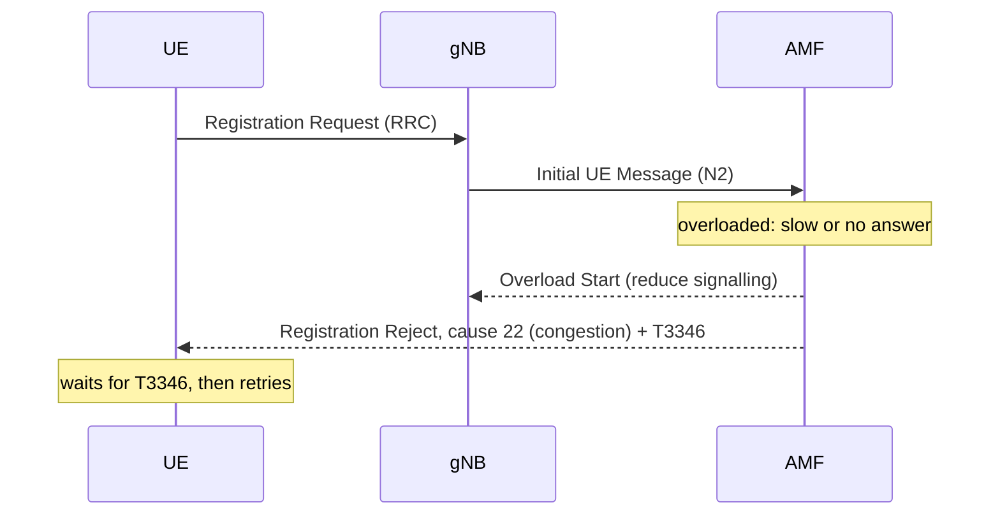
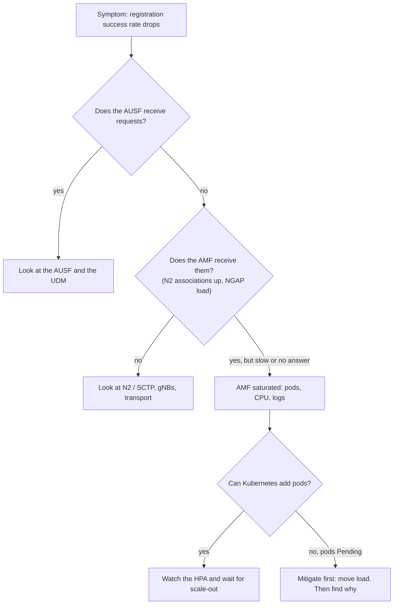

# Scenario: the AMF is overloaded and the platform cannot create more instances

Back to [topic 01](../README.md). Terms link to the [glossary](../../glossary.md).

## Symptom

- The registration success rate of the network drops. Subscribers see signal bars but cannot start calls or data sessions; some phones sit "searching" or retry.
- The [**AUSF**](../../glossary.md#ausf) receives almost nothing, although subscribers are trying to register.
- In Kubernetes, new [**AMF**](../../glossary.md#amf) pods stay in `Pending`.

## Context and assumptions

- The [**5GC**](../../glossary.md#5gc) runs on Kubernetes; the AMF is a Deployment (or StatefulSet) scaled by a [**HPA**](../../glossary.md#hpa).
- A second AMF exists in another cluster and belongs to the same [**AMF Set**](../../glossary.md#amfset). The gNBs have an N2 association to both.
- The cluster cannot schedule more AMF pods (no free capacity, nodes down, or a quota is exhausted).

## What happens

1. Registrations arrive faster than the AMF can process them. Queues grow and the AMF answers late or not at all.
2. Nothing reaches the AUSF, because the AMF only calls it after receiving and processing the request (see the flow in [topic 01](../README.md)).
3. The HPA asks for more replicas, but the scheduler cannot place them: pods stay `Pending`.
4. The network has built-in ways to slow the load down:
   - The AMF can tell a gNB to reduce signalling towards it with the NGAP **Overload Start** procedure (TS 38.413, clause 8.7.7).
   - The AMF can reject NAS requests with 5GMM cause #22 (*congestion*) and a back-off timer, [**T3346**](../../glossary.md#t3346), so that UEs wait before retrying (TS 24.501, clause 5.3.9). The spec suggests varied timer values so the UEs do not retry all at once.



## What is affected

- **New registrations**: most visible.
- **Other procedures that go through the AMF**, such as service requests of idle phones that wake up and mobility updates, because the same AMF serves them. Subscribers who are already active may keep working for a while, which is why the first complaints sound partial.
- **Downstream functions** see less traffic, not more: this is why an empty trace on the AUSF points upstream.

## Where to start

Use the message flow as a map and walk it backwards until the messages stop appearing.



First translate the complaint into a measurable symptom: the registration success rate, and its scope (all subscribers or some, one region or all, only new registrations or also existing ones). "They cannot call" is far from the cause: a voice call also needs a data session and IMS registration.

Kubernetes checks (namespace `core` and label `app=amf` are examples; adjust them):

```
kubectl get pods -n core -l app=amf -o wide
kubectl describe pod <pending-amf-pod> -n core
kubectl get events -n core --sort-by=.lastTimestamp
kubectl top pods -n core
kubectl get hpa -n core
kubectl get nodes
kubectl describe node <node>
```

- `get pods -l app=amf -o wide`: lists the AMF pods (`-l` filters by label, `-o wide` adds node and IP). Look for `Pending`, `CrashLoopBackOff` and many restarts.
- `describe pod`: the **Events** section at the end gives the reason, for example `FailedScheduling: 0/N nodes are available: Insufficient cpu`.
- `get events --sort-by=.lastTimestamp`: namespace events in time order, to see what happened first.
- `top pods`: current CPU and memory use (needs metrics-server); confirms whether the running pods are saturated.
- `get hpa`: shows whether the autoscaler already reached its maximum or cannot scale.
- `get nodes`: shows nodes that are `NotReady` or cordoned.
- `describe node`: **Allocated resources** compares requests against what the node can offer.

Also check the AMF logs and the N2 association state on the AMF side.

## Hypotheses

| Hypothesis | Evidence that supports it |
|---|---|
| Cluster out of capacity | `FailedScheduling ... Insufficient cpu/memory`; nodes fully allocated |
| Nodes lost or unschedulable | Nodes `NotReady`, cordoned, or with taints the AMF does not tolerate |
| Namespace quota exhausted | Events mention `exceeded quota` |
| Scheduling constraints | Anti-affinity or topology rules leave no valid node |
| Another workload consumes the cluster | `top` shows non-AMF pods using the capacity |
| Autoscaler cannot add nodes | Node group at its limit, or cloud/hardware quota reached |
| Real traffic spike or a retry storm | Registration rate far above the normal pattern; many UEs retrying |

## Mitigate now vs. fix the root cause

**Mitigate (first minutes): move or reduce the load, without creating a second incident.**

- Shift new registrations to the AMF in the other cluster by lowering the weight of the overloaded AMF so the gNBs prefer the others (the NGAP *Relative AMF Capacity* information is meant for this; † see accuracy note).
- Do it in steps, checking the capacity of the target first. Moving everything at once can overload the backup too.
- Let the built-in overload control work: Overload Start towards the gNBs and congestion rejects with T3346 on the UEs.
- Free capacity in the cluster if that is quick and safe (stop low-priority workloads).

**Fix the root cause (after service is stable):** find out why the cluster could not schedule the pods (capacity, hardware, network, quota, scheduling rules), then fix that.

## Prevention

- **Dimension the backup for the full load**, not for the average (N+1 or better), and revisit it as traffic grows.
- **The failover must be prepared in advance**: gNBs already have the N2 association to the backup AMF, and the backup is in the same AMF Set so it can serve the same subscribers. This cannot be improvised during an incident.
- **Test the failover regularly**; an untested failover tends to fail.
- Keep headroom in the cluster and alarms on pending pods, HPA at its maximum, and registration success rate.
- Priority classes so that the AMF can preempt less critical workloads.

## Standard vs. implementation

| Defined by the standard | Left to the vendor / operator |
|---|---|
| AMF Sets, the NGAP overload and configuration procedures, congestion cause #22 and T3346 | How and when overload is declared, and thresholds |
| What a gNB does when told to reduce signalling | How the operator triggers a rebalancing (OAM command, automation, load balancer) |
| | Kubernetes layout, autoscaling policy, capacity numbers, alarms and dashboards |

## Accuracy note

Checked against the specs: Overload Start purpose (TS 38.413 cl. 8.7.7) and the congestion handling with cause #22 and T3346 (TS 24.501 cl. 5.3.9). Not yet checked against the clause text (†): that the AMF Configuration Update procedure (TS 38.413 cl. 8.7.3) is the one that changes the relative weight of an AMF, and the exact clauses of the AMF Set and AMF selection rules in TS 23.501.

## References

- 3GPP TS 38.413, *NG-AP*: Overload Start (cl. 8.7.7), AMF Configuration Update (cl. 8.7.3), Relative AMF Capacity IE (cl. 9.3.1.32). <https://www.3gpp.org/ftp/Specs/archive/>
- 3GPP TS 24.501, *NAS protocol for 5G*: NAS level congestion control (cl. 5.3.9).
- 3GPP TS 23.501, *System architecture for the 5G System*: AMF Set and AMF selection.
- Kubernetes: [Horizontal Pod Autoscaling](https://kubernetes.io/docs/tasks/run-application/horizontal-pod-autoscale/), [Scheduling and eviction](https://kubernetes.io/docs/concepts/scheduling-eviction/), [kubectl reference](https://kubernetes.io/docs/reference/kubectl/).
