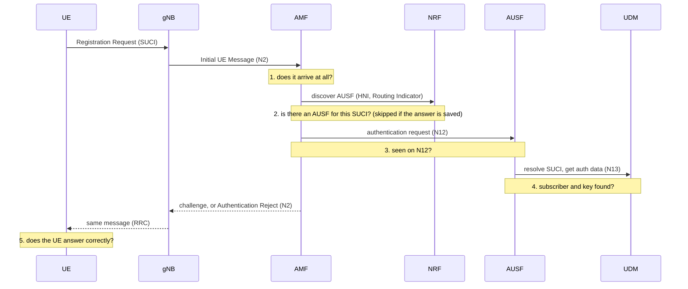
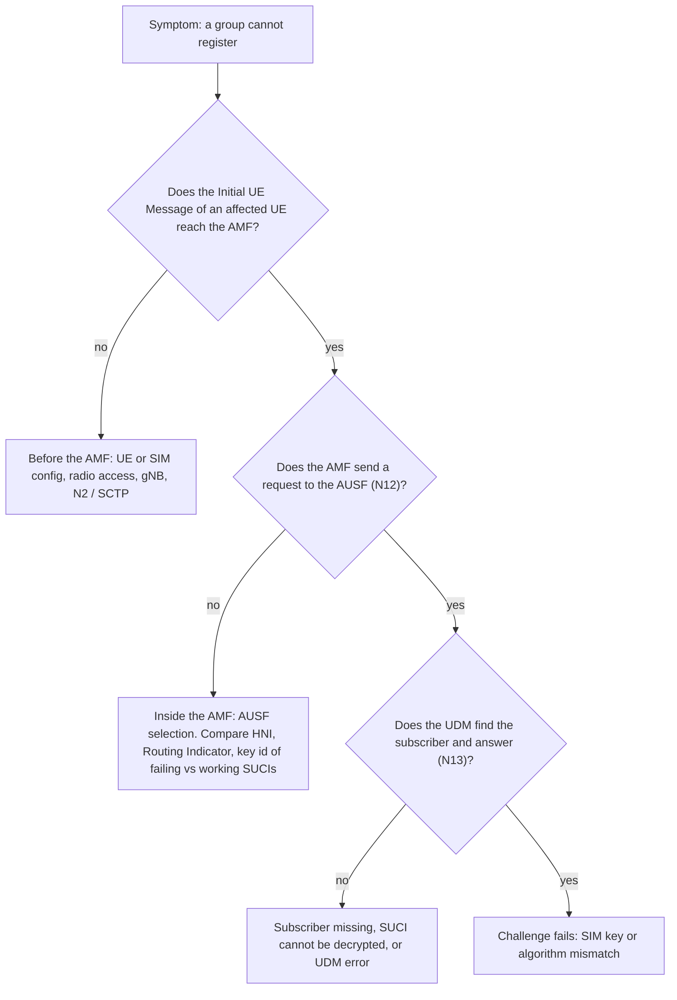

# Scenario: a subset of subscribers cannot register

Back to [topic 01](../README.md). Terms link to the [glossary](../../glossary.md).

## Symptom

- Most subscribers register normally, but a group of them cannot. They keep retrying or show "no service".
- The group is small and stable: the same subscribers fail every time.
- Dashboards of the core functions look healthy: no overload, no pod restarts, no alarms.

## Context and assumptions

- The [**5GC**](../../glossary.md#5gc) is healthy: the [**AMF**](../../glossary.md#amf), [**AUSF**](../../glossary.md#ausf), [**UDM**](../../glossary.md#udm) and [**NRF**](../../glossary.md#nrf) run and answer other subscribers.
- Everything else being equal, the failing subscribers must **differ in something** from the working ones. Finding that difference is the whole exercise.
- Only the AMF talks to the [**UE**](../../glossary.md#ue) (over [**N1**](../../glossary.md#n1)). Whatever fails deeper in the core reaches the UE as a message from the AMF.

## What happens

Walk the [registration flow](../README.md) and ask, at each hop, "could this step behave differently for a few subscribers?":

1. The UE sends a Registration Request containing a [**SUCI**](../../glossary.md#suci). The gNB forwards it to the AMF in an Initial UE Message ([TS 38.413 cl. 8.6.1](https://itecspec.com/3gpp/38.413/s/8.6.1)).
2. The AMF must choose an AUSF. It uses the NRF unless it is configured locally. Among the inputs are the [**Home Network Identifier**](../../glossary.md#hni) and the [**Routing Indicator**](../../glossary.md#routing-indicator) taken from the SUCI ([TS 23.501 cl. 6.3.4](https://itecspec.com/3gpp/23.501/s/6.3.4) †). Subscribers whose SUCI carries a different value may lead to a different AUSF, or to none.
3. The AMF sends the authentication request to the AUSF over [**N12**](../../glossary.md#n12).
4. The AUSF asks the UDM ([**N13**](../../glossary.md#n13)); the UDM resolves the SUCI back to the SUPI and looks the subscriber up. This is where "the subscriber does not exist" or "the SUCI cannot be decrypted" would show up.
5. The challenge goes back to the UE through the AMF. If the UE's answer is wrong, the check fails in the AMF/AUSF and, if the UE had sent a SUCI, the AMF sends an Authentication Reject ([TS 33.501 cl. 6.1.3.2.2](https://itecspec.com/3gpp/33.501/s/6.1.3.2.2) †).



## What is affected

- **Only the subscribers that share the difference.** Everyone else keeps registering, so aggregate success rate drops only a little: this is why the problem can hide for days.
- **Existing sessions of the failing subscribers** usually keep working if they registered before the difference appeared, while new registrations and re-registrations fail (this depends on the cause, so confirm it).
- **Nothing else in the core** is degraded, so health dashboards stay green.

## Where to start

Three moves: scope the group, find the difference, then bisect the flow with the evidence each hop leaves.

1. **Scope the group.** Pick a few failing and a few working subscribers (ideally 3 + 3). Compare what they have in common: SIM batch or provisioning date, the SUCI fields, the tracking area or gNB they use, device model, the plan.
2. **Bisect the flow** with this map:



An absent N12 request alone does not say whether the request stopped **before** the AMF or **inside** it: that is why question 1 comes first.

All of the following is read-only: it looks at evidence that already exists and changes nothing. Namespace `core` and the labels are examples; adjust them.

```
kubectl logs -n core -l app=amf --since=30m --tail=500
kubectl logs -n core -l app=ausf --since=30m --tail=500
kubectl logs -n core -l app=udm --since=30m --tail=500
kubectl get pods -n core -o wide
```

- `logs -l app=amf`: reads the logs of every pod with that label (`-l` selects by label). `--since=30m` limits the window and `--tail=500` the number of lines per pod. Search for one failing subscriber identifier and see how far its messages travel.
- The same command on `ausf` and `udm` shows whether the request arrived there.
- `get pods -o wide`: confirms all pods are `Running` and on which nodes (`-o wide` adds the node and IP).

To see the SUCI itself, capture the N2 traffic on a node that carries it and open the file in Wireshark, which decodes NGAP and NAS. The captured SUCI shows its non-encrypted fields (home network, Routing Indicator, scheme and key id); only the scheme output is encrypted. Compare those fields between a failing and a working UE:

```
tcpdump -i any -w /tmp/n2.pcap sctp
```

- `tcpdump -i any`: captures on all interfaces. `-w /tmp/n2.pcap` writes raw packets to a file instead of printing them. `sctp` is the filter: N2 runs over SCTP. Check the policy of your environment before capturing, because a trace contains subscriber identifiers.

## Hypotheses

| Hypothesis | Evidence that supports it |
|---|---|
| Different Routing Indicator (for example a new SIM batch) and no AUSF serves it † | Failing SUCIs carry a value that working ones do not; the AMF logs no AUSF found, and there is no request on N12 |
| Less likely: a different Home Network Identifier (a second network code used by a subset of SIMs) not covered by the core configuration | Failing SUCIs show another MCC/MNC. For plain home subscribers this is unusual: a different home network usually means roaming, which goes through other functions |
| Home Network Public Key Id or protection scheme not provisioned, so the SUCI cannot be decrypted † | Request reaches the UDM side, but the SUCI cannot be resolved |
| Subscriber missing in the UDM database | Request reaches the UDM; lookup fails for those subscribers only |
| Wrong key or algorithm on the SIM | Challenge is issued but authentication does not complete. The UE may detect the mismatch itself and report a failure, or its answer may not match; which message results is not yet verified in the specs † |
| The request never reaches the AMF | No Initial UE Message in the AMF for those UEs; look at the UE configuration, radio access, the gNB or the N2 path |

## Mitigate now vs. fix the root cause

**Mitigate (first minutes).** Confirm the scope and the difference before touching anything. If the affected group is large or critical, the quick action is the one that makes the core accept what the SIMs actually send, for example adding the missing value to the AMF/NRF/AUSF configuration for that group. Do it as a controlled change: test with a single subscriber first, then widen. Where the cause is in the SIM data, swapping or reprovisioning SIMs is slow and is the fix, not the mitigation.

**Fix the root cause.** Correct the provisioning on the side that is wrong (core configuration, UDM data or SIM batch) and then close the gap that let it ship.

## Prevention

- Check the parameters of every new SIM batch against the core configuration **before** the batch ships: home network, Routing Indicator, protection scheme and key id.
- Run a test registration with a SIM from each new batch (a canary) before general distribution.
- Report registration success **per dimension** (Routing Indicator, home network, SIM batch, tracking area). An aggregate rate hides a small failing group.
- Alarm on "no AUSF found" or equivalent selection failures in the AMF.

## Standard vs. implementation

| Defined by the standard | Left to the vendor / operator |
|---|---|
| The parts of the SUCI and what they mean ([TS 23.003 cl. 2.2B](https://itecspec.com/3gpp/23.003/s/2.2B) †) | Log format and the exact wording of selection failures |
| The factors used to select an AUSF and the default Routing Indicator behaviour ([TS 23.501 cl. 6.3.4](https://itecspec.com/3gpp/23.501/s/6.3.4) †) | What the AMF does when a non-default Routing Indicator matches no AUSF: that case is not described in that clause |
| Authentication Reject after a failed check with a SUCI ([TS 33.501 cl. 6.1.3.2.2](https://itecspec.com/3gpp/33.501/s/6.1.3.2.2) †) | What the subscriber sees in the other cases (no answer, or a reject with some 5GMM cause): the cause value is not cited here until checked in TS 24.501 |
| | How the operator provisions SIMs, the UDM and the routing configuration |

## Accuracy note

Partly checked (†): the SUCI fields and the AUSF selection factors were read through reader summaries of TS 23.003 cl. 2.2B and TS 23.501 cl. 6.3.4, not the official documents. Where the page says the AMF may find no AUSF for an unmatched Routing Indicator, that is a **hypothesis from the factors listed in the clause**, not a behaviour the standard states. 5GMM cause values are deliberately not quoted: they have not been checked in [TS 24.501](https://www.3gpp.org/ftp/Specs/archive/24_series/24.501/). The "what the UE sees" column is therefore implementation behaviour.

## References

- 3GPP TS 23.003, *Numbering, addressing and identification*: structure of the SUCI ([cl. 2.2B](https://itecspec.com/3gpp/23.003/s/2.2B)).
- 3GPP TS 23.501, *System architecture for the 5G System*: AUSF selection ([cl. 6.3.4](https://itecspec.com/3gpp/23.501/s/6.3.4)), NRF discovery ([cl. 6.3.1](https://itecspec.com/3gpp/23.501/s/6.3.1)).
- 3GPP TS 33.501, *Security architecture and procedures for 5G system*: 5G AKA failure handling ([cl. 6.1.3.2.2](https://itecspec.com/3gpp/33.501/s/6.1.3.2.2)).
- 3GPP TS 38.413, *NG-AP*: Initial UE Message ([cl. 8.6.1](https://itecspec.com/3gpp/38.413/s/8.6.1)). <https://www.3gpp.org/ftp/Specs/archive/>
- All sources of the repository: [references](../../references.md).
- Kubernetes: [kubectl logs](https://kubernetes.io/docs/reference/kubectl/generated/kubectl_logs/). Wireshark: [display filter and NGAP/NAS dissectors](https://www.wireshark.org/docs/).
